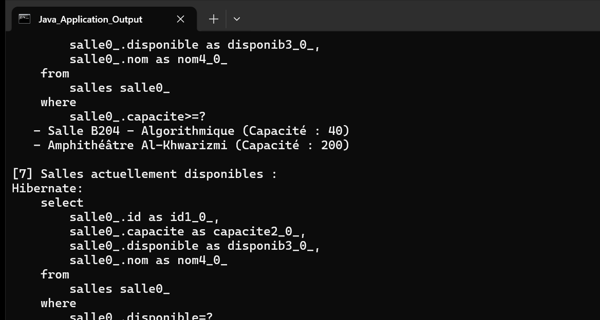

# TP 2 : Gestion des Salles et Utilisateurs avec JPA et Hibernate

Application Java console de modélisation et de gestion d'entités JPA (`Salle` et `Utilisateur`) avec Hibernate 5.6 et une base de données en mémoire H2, sans conteneur EJB/JTA (mode `RESOURCE_LOCAL`).

---

## Architecture du Projet

* **Entités JPA** (`com.example.jpa.entities`) :
  * `Salle` : Identifiant auto-généré, nom unique, capacité d'accueil et statut de disponibilité.
  * `Utilisateur` : Identifiant auto-généré, nom complet, adresse email unique, relation `@ManyToOne` vers `Salle`.
* **Couche DAO** (`com.example.jpa.dao`) :
  * `GenericDao<T>` : Opérations CRUD génériques (`create`, `find`, `update`, `delete`, `findAll`) avec transactions manuelles (`EntityTransaction`).
  * `SalleDao` : Requêtes JPQL filtrées par seuil de capacité minimale et disponibilité.
  * `UtilisateurDao` : Requête JPQL avec jointure pour retrouver les utilisateurs d'une salle par nom.
* **Couche Service** (`com.example.jpa.service`) :
  * `ServiceGestion` : Point d'accès métier et gestion du cycle de vie de l'`EntityManagerFactory`.
* **Application & Tests** :
  * `Main` : Démonstration complète des fonctionnalités en console.
  * `ServiceGestionTest` : Suite de tests unitaires JUnit 4.

---

## Exécution

Pour compiler et exécuter l'application console :

```bash
mvn compile exec:java
```

Pour lancer les tests unitaires :

```bash
mvn test
```

---

## Résultat d'Exécution de l'Application

Capture d'écran du terminal affichant le résultat de l'exécution du programme Java (`Main`) :



### Description du résultat d'exécution :
1. **Démarrage et Schéma** : Hibernate initialise la base H2 en mémoire et applique le schéma relationnel (tables `salles`, `utilisateurs`, contraintes d'unicité et clé étrangère).
2. **Création des Entités** : Insertion de trois salles (`Salle B204 - Algorithmique`, `Amphithéâtre Al-Khwarizmi`, `Laboratoire IA & Réseaux`) et de trois utilisateurs associés.
3. **Affichage des Données** : Liste complète des salles et utilisateurs persistés en base.
4. **Requêtes JPQL** :
   - Recherche des utilisateurs rattachés à la salle `Salle B204 - Algorithmique`.
   - Filtrage des salles ayant une capacité supérieure ou égale à 30 places.
   - Filtrage des salles actuellement disponibles.
5. **Clôture** : Fermeture propre de l'EntityManager et de la connexion H2 sans erreurs.
