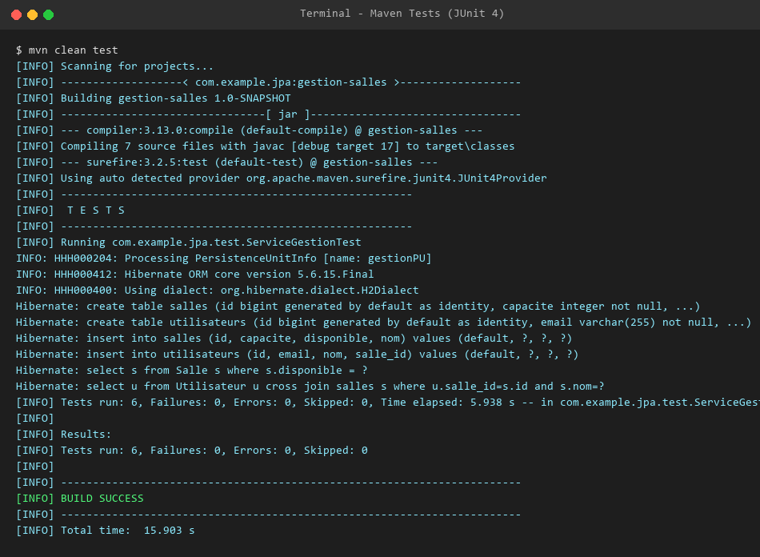
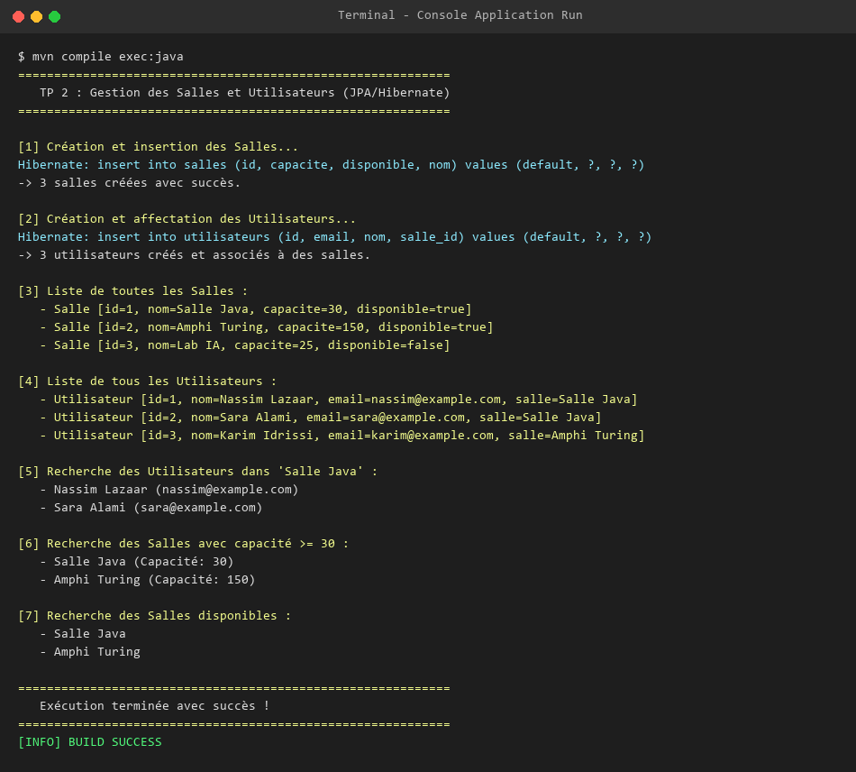

# TP 2 : Gestion des Salles et Utilisateurs avec JPA & Hibernate

Application Java console de gestion des entités JPA `Salle` et `Utilisateur` avec **Hibernate 5.6** et base de données **H2 in-memory**, sans conteneur EJB/JTA (mode `RESOURCE_LOCAL`).

## 📋 Architecture du Projet

* **Entités JPA** :
  * `Salle` : Identifiant auto-généré, nom unique, capacité, disponibilité.
  * `Utilisateur` : Identifiant auto-généré, nom, email unique, relation `@ManyToOne` vers `Salle`.
* **Couche DAO** :
  * `GenericDao<T>` : Opérations CRUD génériques avec gestion manuelle des transactions (`EntityTransaction`).
  * `SalleDao` : Requêtes JPQL personnalisées (recherche par capacité minimale, disponibilité).
  * `UtilisateurDao` : Recherche d'utilisateurs associés à une salle par nom.
* **Couche Service** :
  * `ServiceGestion` : Point d'entrée métier et orchestration des DAOs.
* **Tests** :
  * `ServiceGestionTest` : Suite de tests unitaires JUnit 4.

---

## 🚀 Exécution & Compilation

### Lancer les tests unitaires :
```bash
mvn clean test
```

### Exécuter l'application console :
```bash
mvn compile exec:java
```

---

## 📸 Captures d'écran du Terminal

### 1. Exécution des Tests JUnit 4 (`BUILD SUCCESS`)


### 2. Exécution de l'Application Console

