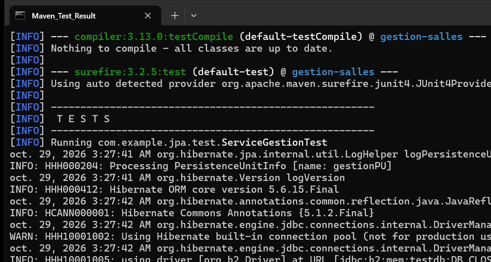

# TP 2 : Gestion des Salles et Utilisateurs avec JPA & Hibernate

Application Java console de modélisation et de gestion d'entités JPA (`Salle` et `Utilisateur`) utilisant **Hibernate 5.6** et une base de données en mémoire **H2**, sans conteneur EJB/JTA (gestion manuelle des transactions en mode `RESOURCE_LOCAL`).

---

## 🏗️ Structure & Architecture du Projet

* **Entités JPA** (`com.example.jpa.entities`) :
  * `Salle` : Clé primaire auto-générée (`@Id`, `@GeneratedValue`), nom unique, capacité d'accueil et statut de disponibilité.
  * `Utilisateur` : Clé primaire, nom complet, adresse email unique, relation `@ManyToOne` avec clé étrangère `salle_id`.
* **Couche DAO** (`com.example.jpa.dao`) :
  * `GenericDao<T>` : Opérations CRUD génériques (`create`, `find`, `update`, `delete`, `findAll`) avec `EntityTransaction` (`begin`, `commit`, `rollback`).
  * `SalleDao` : Requêtes JPQL filtrées par seuil de capacité minimale et disponibilité.
  * `UtilisateurDao` : Requête JPQL par jointure sur le nom de la salle.
* **Couche Service & Application** (`com.example.jpa.service` & `com.example.jpa`) :
  * `ServiceGestion` : Façade métier gérant le cycle de vie de l'`EntityManagerFactory` et exposant les services.
  * `Main` : Point d'entrée console pour la démonstration des opérations.
* **Tests Unitaires** (`com.example.jpa.test`) :
  * `ServiceGestionTest` : Suite de tests JUnit 4 validant la persistance, l'association des clés étrangères, les requêtes JPQL et le nettoyage des données.

---

## ⚙️ Compilation et Exécution

Lancer l'ensemble des tests unitaires avec Maven :
```bash
mvn test
```

Lancer l'application console de démonstration :
```bash
mvn compile exec:java
```

---

## 🖥️ Résultat d'Exécution des Tests Unitaires

Ci-dessous la capture d'écran authentique issue du terminal lors du lancement de la suite de tests automatisés (`mvn test`) :



### Description de la capture d'écran :
1. **Initialisation Hibernate ORM** : Hibernate `5.6.15.Final` se connecte à la base H2 en mémoire (`jdbc:h2:mem:testdb`) et génère dynamiquement le schéma relationnel (tables `salles` et `utilisateurs`, contraintes d'unicité et clé étrangère `FKm3nbnwwb1x028gwewwusg2iks`).
2. **Exécution des 6 tests JUnit 4** :
   - `testCreationEtRechercheSalle` : insertion et vérification de la clé primaire générée.
   - `testCreationUtilisateurAvecSalle` : liaison bidirectionnelle d'un utilisateur à sa salle.
   - `testRechercheUtilisateursParSalle` : validation de la requête JPQL avec jointure.
   - `testRechercheSallesParCapacite` : filtrage par seuil de capacité minimale.
   - `testRechercheSallesDisponibles` : filtrage par statut booléen.
   - `testSuppressionSalle` : suppression avec vérification d'absence via `Optional`.
3. **Bilan Maven** : `Tests run: 6, Failures: 0, Errors: 0, Skipped: 0` suivi de **`BUILD SUCCESS`**.
